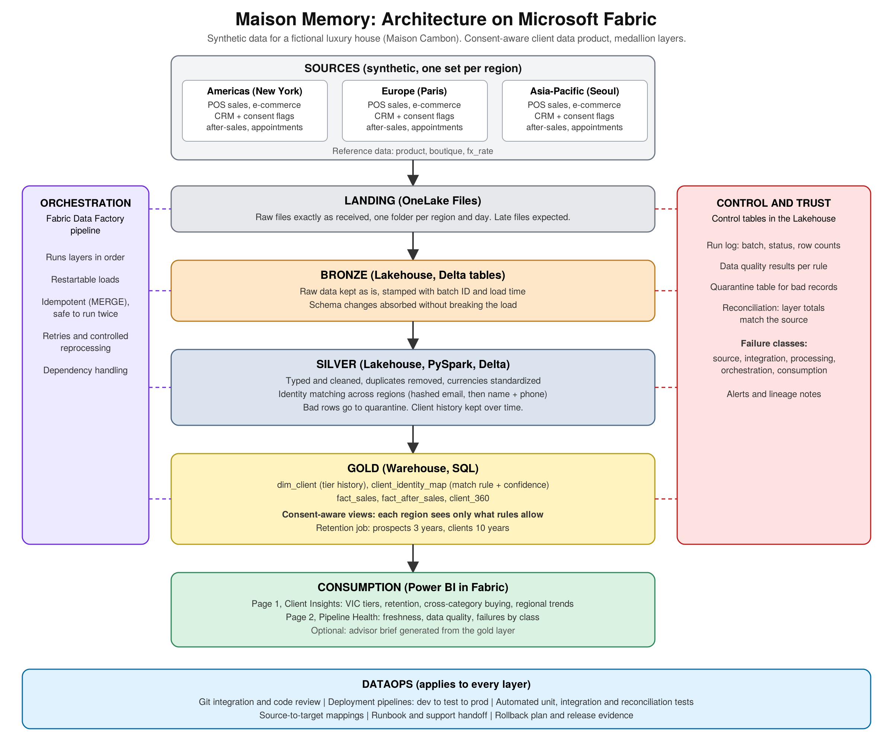

# Maison Memory


**What if every advisor recognized a top client the moment she walked in, in any city, without breaking her consent?**

Maison Memory is a data engineering project that builds a trusted, consent-aware client data product on **Microsoft Fabric** for a fictional luxury house, Maison Cambon.

> **Maison Cambon is a fictional luxury house. All data in this repository is synthetic.** This project is modeled on publicly available information about enterprise data platforms and on the kind of global client account that luxury houses describe in their public privacy policies. It is an independent portfolio project and is not affiliated with, endorsed by, or connected to Chanel or any other real brand.

## The problem

A client might buy a bag in New York, get a repair in Seoul and order skincare online from Paris. Each region runs its own systems under its own rules. Giving advisors one joined-up view is easy to promise and hard to keep true: identities must be matched, consent respected, history preserved and failures caught before they reach a report.

## What this project does

- Ingests raw files from three regions (Americas, Europe, Asia-Pacific) into a **medallion architecture** (bronze, silver, gold)
- Matches the same client across regions and records how each match was made
- Applies **consent rules** so a region only sees what the client allows
- Keeps **client history** (consent, contact and segment changes) over time, and applies **retention and erasure** rules
- Embeds **data quality checks, reconciliation, quarantine and failure classification** in every run
- Delivers a **Power BI report** with two pages: Client Insights and Pipeline Health

## Architecture



Full design: [docs/architecture/design.md](docs/architecture/design.md)

## Tech stack

| Area | Tools |
|---|---|
| Platform | Microsoft Fabric (OneLake, Lakehouse, Warehouse) |
| Orchestration | Fabric Data Factory pipelines |
| Processing | PySpark notebooks, SQL, Delta Lake |
| Reporting | Power BI |
| DataOps | Git, pytest, GitHub Actions |
| Data generation | Python (pandas, numpy, Faker) |

## Key engineering ideas

1. **Restartable and idempotent loads.** Batch IDs plus MERGE, so running twice never duplicates data.
2. **Schema evolution.** A source adds a column mid-stream and the pipeline keeps running.
3. **Auditable identity matching.** Every match stores its rule and confidence score.
4. **Consent as a rule, not an assumption.** Cross-region visibility is enforced in gold views.
5. **Privacy by design.** Synthetic data, hashed emails, masked names.
6. **Retention.** Scheduled removal of prospects and clients after defined periods.
7. **Failure classification.** Source, integration, processing, orchestration or consumption, so the right team is told.

## Repository structure

```
data_generator/     Python script that creates the synthetic regional data
data/raw/           Generated files (not committed)
notebooks/
  bronze/           Raw files to Delta
  silver/           Cleaning, sales, history and retention, identity matching
  gold/             Business-ready tables
  eval/             Identity match accuracy against ground truth
  orchestration/    Pipeline driver and load logging
pipelines/          Pipeline definition (JSON)
sql/gold/           Warehouse load, regional views, security, checks
tests/              pytest tests, run by GitHub Actions
docs/
  architecture/     Design, as-built notes and diagram
  runbooks/         Failure classes and recovery steps
  mappings/         Source-to-target mapping
  images/           Report and pipeline screenshots
powerbi/            Report description and screenshots
```

## Results

| Measure | Value |
|---|---|
| Identity match precision | 1.00 |
| Identity match recall | 0.747 |
| Gold reconciliation checks | All pass |
| Automated tests | 47 pass in GitHub Actions |

Details and limits: [runbook](docs/runbooks/runbook.md), [as built](docs/architecture/as_built.md), [mappings](docs/mappings/source_to_target.md), [Power BI](powerbi/README.md).

## Status

- [x] Design and architecture
- [x] Synthetic data generator
- [x] Bronze layer
- [x] Silver layer
- [x] Gold layer and Warehouse views
- [x] Orchestration, control tables and failure classification
- [x] Tests and CI
- [x] Power BI report
- [x] Runbook and mappings

## About

Built by Prathiksha, a data engineer, as a hands-on exploration of production-style data products on Microsoft Fabric.

## License

MIT
