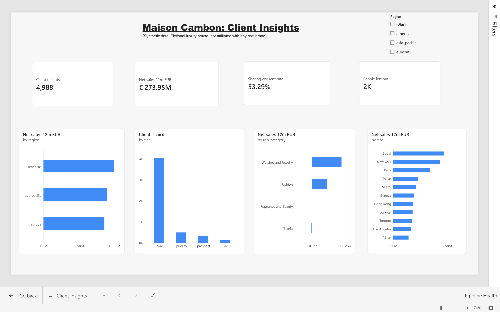
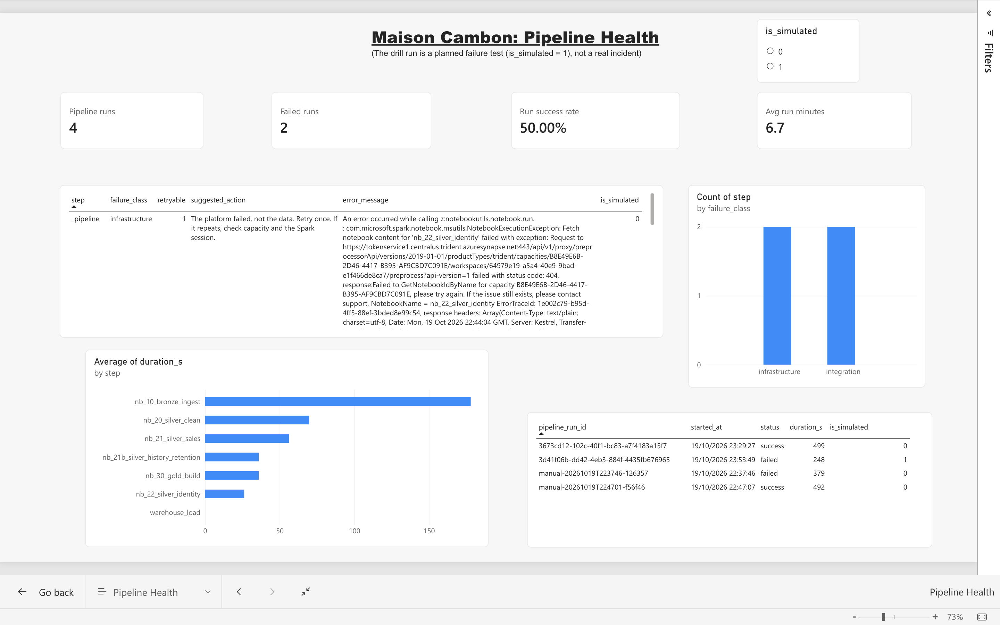

# Power BI report

Built in the Fabric web editor on a semantic model (`sm_maison`) over the Warehouse `maison_gold`. Report files are not exported, so the screenshots below and this description are the record.

## Model

Tables: `client_360`, `dim_client`, `dim_boutique`, `governance_summary`, `pipeline_run`, `dq_results`.

Relationships: `client_360[client_id]` one to one with `dim_client[client_id]`; `dim_client[home_boutique_id]` many to one with `dim_boutique[boutique_id]`.

Names and other identifiers are hidden. The report shows totals only. The model reads base tables, so the per-region roles from `sql/gold/04_security.sql` do not apply here.

## Measures

Client records, Net sales 12m EUR, Sharing consent rate, People total, People in global profile, People left out, Pipeline runs, Failed runs, Run success rate, Avg run minutes. The pipeline measures count the `_pipeline` summary row of each run.

## Pages

- **Client Insights:** clients, 12 month net sales, consent rate, people left out of the global profile (not enough consent), sales by region, tier, category and boutique city.
- **Pipeline Health:** runs, failures, success rate, step duration, failures by class, and the failure details with the suggested action. Drill runs (`is_simulated = 1`) are planned tests and can be filtered out.

## Refresh

Run `sql/gold/06_ops_tables.sql` after each pipeline run to refresh the run log copy.
